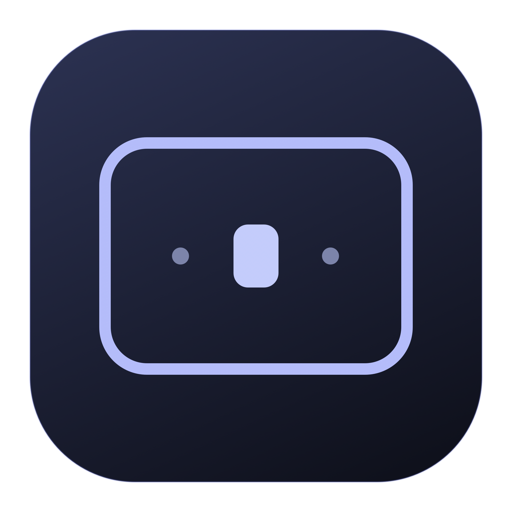

<p align="center"></p>
<h1 align="center">amspace</h1>
<p align="center">Your space. Your focus.<br>A discreet companion for the macOS menu bar, written in Rust.</p>
<p align="center"><a href="README.md">Español</a> · <a href="README.en.md">English</a></p>

AMSpace shows where you are at a glance: numbers, dots or icons per desktop. The active one stands out and the others appear dimmed. Left-click a number, dot or icon to switch to that desktop. Right-click opens native settings, compact and adapted to the system's light or dark appearance.

## Context

A personal project developed by **Alberto Martín** for his own use, using **Astra** and **Qwen 3.8 Flash Next**. The application remains in Spanish; English control names below are descriptive translations. Optimization and minimal resource use are top priorities: it is designed for my laptop and my desktop workstation with two monitors, one landscape and one portrait. That setup guides the design, but does not imply universal compatibility or the best possible performance on every machine. [VALIDATION.md](docs/VALIDATION.md) records measurements, scenarios actually tested, and their limits.

- Instagram: [@amartinro](https://www.instagram.com/amartinro/)
- X: [@amartinro](https://x.com/amartinro)
- GitHub: [amartinrojarvis](https://github.com/amartinrojarvis)
- Other websites by the author: [tufotoyvideopromocional.es](https://tufotoyvideopromocional.es/) · [iaparafilmmakers.es](https://www.iaparafilmmakers.es/) · [vilens.es](https://vilens.es/)
- Contact: [a.martinro@gmail.com](mailto:a.martinro@gmail.com)

## Features

- **Current desktop.** Three modes: Dots, Numbers and Icons. 30 native icons (work, code, video, photography, communications, audio, tasks, etc.) and the option to keep a number on each desktop. The active one stands out in white in dark mode; the color adapts to the system appearance. From ten desktops it compacts to `3 / 12`.
- **Desktop switching from the bar.** Each number, dot or icon is a button. Left-click selects that desktop and right-click opens settings. With more than nine desktops, the compact indicator opens a selection list.
- **Desktop preview.** Holding the cursor over an indicator shows a thumbnail of the window layout, with its applications' icons. Compact, translucent popup, without capturing content or requiring Screen Recording. Disabled in Menu bar. Available with individual indicators (up to nine desktops).
- **Active window border.** Inner outline with no separation, with corner radius read from the system, mouse-transparent, free color or four palettes and thickness from 1 to 6 points, in steps of 0.5.
- **Focus under cursor.** Activates the keyboard of the window after the mouse stops for about 240–390 ms, even between windows of the same application, without changing their order. Paused while dragging or holding ⌥, and it skips AMSpace's own windows. Leaving its settings with the cursor lets you focus another app.
- **Bring to front.** Independent setting, initially off: in addition to focusing, it raises the window above the others.
- **Optional mosaic.** Layouts per desktop, grouping of windows into tabs, drag with preview and floating windows via a configurable shortcut.
- **Mission Control.** The border panel hides with the desktops view and reappears when returning to the desktop.
- **Login.** Registration with `SMAppService`, managed by macOS. Initially off.
- **Updates from the app.** Installed version, manual check, optional daily notices, verified download and restart via Sparkle.
- **About.** Authorship by Alberto Martín and links to Instagram and X: [@amartinro](https://x.com/amartinro).
- **Persistent preferences.** No account and no telemetry. It only connects to GitHub when checking or downloading updates; Sparkle uses helpers during installation.
- **Custom icon.** A rounded window with a highlighted space; vector sources and an `.icns` version are included.

The border, the focus and the tiling are initially off: enable them once you have granted Accessibility.

## Install

Requires **macOS 13 Ventura or later**. [**Download the 0.9.16 installer**](https://github.com/amartinrojarvis/amspace/releases/download/v0.9.16/AMSpace-installer.dmg). The universal package contains Apple Silicon and Intel; local execution is verified on Apple Silicon. See the news and files of the [official release](https://github.com/amartinrojarvis/amspace/releases/tag/v0.9.16).

The current distribution is signed **ad hoc**, without a Developer ID certificate or Apple notarization. A downloaded file may require explicit authorization in Privacy & Security. Do not disable Gatekeeper or SIP; you can also build it locally.

Open the **DMG**, drag AMSpace to **Applications** and read **Léeme primero.rtf** before opening the installed copy. The window explains the steps and the required permission. See the [installation, permissions and privacy guide](docs/INSTALLATION.md). The [ZIP](https://github.com/amartinrojarvis/amspace/releases/download/v0.9.16/AMSpace-universal.zip) is also available.

1. Open AMSpace. It only appears in the menu bar, with no permanent Dock icon.
2. Right-click a desktop in the bar to open settings.
3. Press **Accessibility…** and authorize AMSpace in **System Settings → Privacy & Security → Accessibility**. If it does not appear, add it with `+` from Applications.
4. Return to AMSpace's settings and enable Border, Focus or Mosaic whenever you wish. If macOS asks to restart the app, quit and open it again.
5. Enable **Open at login** if you wish. macOS may ask to confirm the login item.

**The desktop indicator works without Accessibility; switching desktops with a click requires that permission.** Screen Recording and Input Monitoring are not needed. Accessibility is used to query windows, receive focus changes, activate windows and send the native switch to the requested desktop.

## Update from AMSpace

In settings → **General**, press **Check now**, review the news and choose **Install update**. AMSpace downloads, verifies the signature, replaces its package and restarts keeping your preferences. If there is nothing new, it says so. You can enable **Check for updates automatically** to receive daily notices; nothing is installed without your intervention.

The **About…** menu includes the version, authorship and version history. The Ed25519 signature protects both the catalog and the files; the private key stays in the developer's Keychain. It is independent of Apple's signature: while the packages are ad hoc, macOS may require renewing Accessibility after updating them.

## Build

Install the Xcode command line tools and Rust with Cargo. Then:

```sh
git clone https://github.com/amartinrojarvis/amspace.git
cd amspace
./scripts/check.sh
./scripts/bundle.sh
open dist/AMSpace.app
```

Universal build:

```sh
rustup target add aarch64-apple-darwin x86_64-apple-darwin
./scripts/bundle.sh --universal
```

To generate the guided installer from that bundle: `./scripts/dmg.sh`. It produces `dist/AMSpace-installer.dmg` and needs a Finder session during packaging. The end user needs no development tools nor Automation permission. [Installation and permissions details](docs/INSTALLATION.md).

The running application is Rust + AppKit/Core Animation. `scripts/icon.swift` and `scripts/dmg-background.swift` are development tools to draw the icon and the installer background; they are not part of the executable. The packaging downloads Sparkle 2.10.1 from its official repository and verifies a pinned SHA-256 before integrating it. The direct Rust dependencies are `objc2`, `objc2-foundation`, `block2` and `libc`; the versions are pinned in Cargo.lock.

To regenerate the icons: `./scripts/make-icon.sh`. To sign with your certificate, define `SIGNING_IDENTITY` when running the packager. The notarized distribution additionally requires setting up the hardened runtime, signing with Developer ID and submitting the package to the notarization service; this script does not perform those steps.

## Usage and behavior

Left-click selects the pressed desktop; pressing the current desktop does nothing. Right-click opens settings without switching desktop. The switch is direct, without opening the Mission Control view, and it respects the natural scrolling setting. For a distant destination it walks through the intermediate spaces and confirms each change. The automatic focus and the border are paused during that transition. Shortcuts and system settings are not modified.

Settings are organized into **Windows**, **Menu bar**, **Mosaic**, **Shortcuts** and **General**. In Menu bar choose Icons and configure each desktop with its menu; you can mix symbols and numbers. Choices are saved per desktop ID, not by position, to follow it when reordered. A new desktop gets its own initial choice.

In Windows, **Focus follows the cursor** moves the keyboard focus; **Bring to front** separately controls the raising. A partially covered window can receive the keyboard when passing over its visible part without moving the windows covering it.

| State | Indicator |
|---|---|
| Desktop 1 of 3 | `1 · ·` |
| Desktop 2 of 3 | `· 2 ·` |
| Ten or more desktops | `2 / 12` |
| Full-screen application | `▣` |
| Desktops API unavailable | `—` |

The numbers are relative to the normal desktops of the screen containing the pointer, in Mission Control order; if the pointer does not resolve, the screen of the WindowServer active desktop is used. With per-screen Spaces, each monitor numbers its own desktops. Full-screen windows are not counted as normal desktops. The order may change if macOS has reorder Spaces by recent use enabled.

The border follows the window focused by AMSpace and respects its position in the stack; outside that tracking, it uses the front normal window of the active application; it distinguishes windows of the same app and receives creation and close events. It does not surround AMSpace's own settings window.

The settings support keyboard navigation and Accessibility labels. With the app active: `⌘,` opens settings, `⌘W` closes its window and `⌘Q` quits. Closing the settings leaves the indicator working.

The mosaic placements are interpolated with a smooth curve (160 ms, one write per changed attribute in each frame). You can disable that interpolation with **Animate placements** in Mosaic: each window moves to its destination with a single AX write and the timer returns to the repair rhythm. When re-selecting the already active desktop there is no native slide, so AMSpace draws a soft full-screen red frame as confirmation; it turns off with **Border on re-selecting the desktop** in Menu bar. Both switches save their value in `tile.animate` and `flash`.

### Tabs and helpers

- **Right-click or Control-click on a tab:** detach from the group, make floating, move to another group of the same desktop and screen, or close the window. Closing respects the applications' save confirmations; it does not force their termination.
- **Configurable shortcuts in Settings → Shortcuts:** previous tab, next tab and detach the active one. Initially off; their proposed combinations are `⌃⌥←`, `⌃⌥→` and `⌃⌥D`. Editing rejects internal conflicts without losing the previous configuration.
- **Pause Mosaic:** button always visible in the Settings sidebar and an action in the tabs menu. It keeps the layout, cancels pending placements and stops its timer and drag monitor. While paused, windows are not reorganized or moved from AMSpace. Border, focus and desktop navigation remain independent. The pause lasts until resuming or closing the app; it does not change the activation preference.
- **Disablable initial help:** installation, permissions, privacy and gestures in a native window. It can be reopened from General → Installation and help. The "Show help on first uses" checkbox controls the initial help, not the error notices.
- **Concrete reasons:** incompatible destinations explain capacity or minimum sizes; rejected operations show a temporary notice even with Settings closed. There is no new polling for the guide, the menus or the notices.
- **Integrated color:** the active tab uses the color chosen for the border, darkened only when needed to keep the contrast of the title and the close. The icon keeps its original colors on a neutral base. The color is computed when the preference changes and applied to the existing controls, without polling nor additional title queries.

Grouping keeps the configurable limit of **5 tabs** by default (2–20), the outer bar and the separation by dragging. Reducing the maximum does not dissolve existing groups.

## Efficiency

- When idle, there is no window polling with automatic focus and tiling disabled. Automatic update checking is optional, initially disabled, and scheduled once a day.
- Spaces is queried when switching desktop, application or screen and when opening settings. With Mosaic active there is additionally periodic reconciliation to recover missing notifications.
- The border identifies the window by its WindowServer ID. The movement is applied directly from the compositor notification, without redrawing nor waiting for Accessibility. The size updates on the next main-thread turn, with no artificial delay; there is no permanent animation loop.
- The optional focus uses a tolerant timer every 80 ms. It only performs AX and WindowServer hit-testing after the cursor stops, once per position; it does not continuously scan all windows.
- "Show desktop", including the active corner, suspends tiling, focus and border. New windows remain floating on return; previous tiles keep their layout per screen/desktop. On recent macOS the WindowManager presentation is detected from the compositor metadata, with an exit check only while active.
- Open menus keep keyboard tracking even when the cursor leaves their area. Modals, Finder Get Info/Inspector, the Archive Utility and the system service panels (copy progress, Open/Save, Safari View) stay outside the mosaic: they keep their own geometry.
- The mosaic animation and the confirmation frame add no polling: the frames are produced by the already existing timer and the frame uses two unique, replaceable deferred deliveries with a new click.
- The focus under the cursor is paused during macOS secure input and respects password fields, modal dialogs and sheets of the active application, also when completing a deferred activation.
- The bar segments keep their native accessible buttons and actions, with direct drawing of their titles to avoid AppKit snapshots causing continuous repaints. The metadata reading reuses constant keys and walks the native lists without copying them into temporary vectors.
- Focus is suspended and the border hidden when the display sleeps, the machine suspends or the session deactivates.
- Optimized build with LTO, symbol stripping and a single codegen unit.

See [VALIDATION.md](docs/VALIDATION.md) for the local measurements and the real scope of the tests; they are not a guarantee for all machines.

## Known limitations

macOS offers no public API to enumerate all Spaces. The `spaces.rs` module queries metadata through private SkyLight functions resolved at runtime. Sending windows to another desktop uses, when available, the WindowManager bridge; its entry is located by exact name in the Mach-O table of the loaded image, without scanning instructions nor modifying memory. It injects no code, it does not modify the Dock and it does not require disabling SIP. If Apple changes those functions or their data, the indicator shows `—` and the rest of the settings remains available. The border also uses private functions to receive window events, query radii and move only its own panel. The border does not modify the geometry of other apps' windows; the mosaic and the moves do adjust it through Accessibility. Because of those dependencies, this version is meant for direct distribution, not for the Mac App Store.

- When adding, removing or reordering desktops without switching Space, the indicator may update on the next application/desktop switch or when opening its settings.
- The geometry and order of the border are read from WindowServer, with AX notifications as fallback if the private API is unavailable. Some apps and macOS versions may expose incomplete metadata or notifications. The code limits the AX wait times.
- The focus applies only to standard windows; dialogs, menus, desktop and AMSpace windows are skipped. Activation and raising are independent. Activating without raising uses optional SkyLight symbols and may be unavailable if Apple changes them; it does not require disabling SIP.
- The border is an independent panel: it is not injected inside other apps. The movement uses a direct compositor path and the resizing is reactive; atomic synchrony with all frames of another application is not guaranteed. Mission Control, Stage Manager, floating-window apps and full-screen animations may present visual transitions. The border does not attempt to integrate with their private animations.
- Login start requires an installed `.app` package. `cargo run` is not an installation method.
- After rebuilding with an ad hoc signature, macOS may require **removing AMSpace from the Accessibility list and adding the Applications copy again**. Toggling the switch off and on does not always renew the saved signature. On recent system versions the panel may be named "Devices and Data Access" ("Control de dispositivos y acceso a datos").

## Development

```sh
./scripts/check.sh                         # format, Clippy, tests and plist
./scripts/bundle.sh --universal             # builds, packages and verifies the signature
dist/AMSpace.app/Contents/MacOS/amspace --diagnose
python3 scripts/benchmark.py <PID> --seconds 20
swift scripts/benchmark-status.swift --baseline # isolated reproduction, seven seconds
swift scripts/benchmark-status.swift            # optimized drawing, seven seconds
```

[Agent guide](AGENTS.md) · [Development and diagnostics](docs/DEVELOPMENT.md) · [Native contracts and regressions](docs/NATIVE_INVARIANTS.md) · [Architecture](docs/ARCHITECTURE.md) · [Validation and manual tests](docs/VALIDATION.md) · [MIT License](LICENSE)

The preferences live in the `io.github.amartinrojarvis.amspace` domain of `NSUserDefaults`. To uninstall: disable login start, quit the app, remove AMSpace from Applications and withdraw its Accessibility permission if you wish.

## Authorship

Created by **Alberto Martín** · [Instagram @amartinro](https://www.instagram.com/amartinro/) · [X @amartinro](https://x.com/amartinro).

[Update publication](docs/UPDATES.md) · [Sparkle License](docs/SPARKLE-LICENSE.txt) · [Focus and window bridge attribution from yabai](docs/YABAI-LICENSE.txt) · [iss gesture protocol license](docs/ISS-LICENSE.txt) · [strafe attribution](docs/STRAFE-LICENSE.txt)

## Send feedback

Open **Ajustes → General → Enviar feedback…** (Settings → General → Send feedback), or use the application menu. A native panel displays a selectable email address. **Preparar correo** (Prepare email) opens a draft in your default mail client: review and send it yourself. Diagnostics are never attached automatically. If no mail client is configured, use **Copiar dirección** (Copy address) and write from your webmail. AMSpace does not send the message or add background services.

## Tiling per desktop

Enable it in **Settings → Mosaic** after granting Accessibility. The general switch enables the manager; the second one allows excluding the current desktop. Each desktop keeps its template by ID, even if reordered in Mission Control. Visible screens are managed independently and their usable area (Dock and menu bar) is respected.

- **Spiral (default):** successive divisions in clockwise direction. Old Dwindle preferences become Spiral.
- **Symmetric grid:** balanced rows and columns; the last row uses the full width.
- **Centered main:** main with two thirds of the width, full height, and up to two secondaries stacked on each side. The secondaries alternate left and right; if there are more than four secondaries, the two rows on each side are subdivided. With one window the whole area is used; with two, the free side is reserved to keep the main centered. The apps' minimums and the grid may adjust the proportions.
- **Centered XL:** main with two thirds of the width and three secondaries stacked on each side (seven windows).
- **Vertical main:** centered main with two thirds of the height and two secondaries above and two below (five windows). Those orientations are kept even when applied on another screen.
- **Main and secondaries:** main window at 60 % of the width and a column of secondary windows; it stacks on vertical screens.
- **3 / 4 divisions:** three or four columns on a horizontal screen and three or four rows on a vertical one. If there are fewer windows, they occupy the available divisions without gaps; if there are more, they are distributed within them.

Drag a tiled window by its title bar to swap it with the slot of another window on the same desktop. The template's virtual grid is respected, even near its edges and after choosing it from the shortcut: no new divisions are created during that repositioning. The preview shows the destination slot and matches the result on release. If the minimum sizes do not allow the swap, the previous layout is kept. In a move between monitors, smart placement still offers arrival divisions on the edges.

With **Group as tabs** enabled, dropping in the top third of a slot adds the dragged window to that slot as one more tab: the two share a single slot and one of them is visible, the other keeps its exact geometry so that selecting it causes no second adjustment. Dropping in the lower two thirds still swaps slots as always. The strip lives in the mosaic model; each application's native tabs (its `AXTabGroup`) still use their own mechanism.

When dragging between slots in the same layout, the destination shows **both drop zones at once**: “Apilar como pestaña” (Stack as a tab) in the top third and “Intercambiar posiciones” (Swap positions) below. A divider marks the actual boundary, the active zone is highlighted, and icons scale up to **72 pt**, adapting to small slots. Actions that cannot fit are marked unavailable. The overlay does not intercept the mouse or change drop rules.

From version 0.9.8 the tabs sit in a translucent dark bar of **22 points**, **above the window's top edge**, with 4 points of separation. The mosaic reserves that space inside the slot: it does not cover the application's controls, the neighboring windows nor the menu. The active tab is highlighted; single-window groups recover the full height.

Click a tab to activate and raise its window. **Drag within the strip to reorder it**: an insertion marker shows the destination without changing the active window or its size. **Drag outside the strip and release to detach it** into an independent mosaic slot, including an inactive tab; the preview shows its destination. Movements below 6 points remain clicks. If application minimum sizes prevent detachment, reordering is still available. Scroll horizontally when titles do not fit; while dragging, moving the pointer near either end scrolls the content. You can still detach the active window by dragging its title bar. Groups and tab order last for the session and are not saved in templates.

Tab strips retain their panels and controls on their group's desktop through the Space-switch pause. macOS handles visibility on each desktop. If native membership cannot be verified, the safe transition-hiding behavior remains; an interactive strip is never deliberately left on another desktop. Pausing Mosaic, Show Desktop and Mission Control still hide strips.

From **0.9.9**, each tab includes a **×** to request the close of its window, not only to detach it from the group. The application's normal close is used, without forcing the exit nor discarding documents. If the tab was hidden it is selected first, to show any save notice. Canceling that notice keeps the window; the tab is only removed when the close is confirmed. Releasing outside the × cancels the click.

In **Settings → Mosaic → Maximum tabs** the limit per group is configured: **5 by default**, between 2 and 20. Reducing it does not undo existing groups: it prevents adding new members to those already at the limit.

From **0.9.10**, left alignment with 8 points of margin by default, or centered from **Settings → Mosaic → Tab alignment**. The translucent dark background is limited to the strip, with rounded corners, faint border and discreet shadow. The × is shown on the active tab and when hovering the others, without displacing the title nor changing the close area. The tracking uses native events, adding no polling nor continuous animations.

You can drag between visible monitors, even with different orientations, resolutions and scales. Each monitor/desktop pair keeps its own tree; the usable area in macOS points is used and the Dock, menu and margins are respected. Spiral and Main begin stacked on vertical screens. The layouts are also separated when macOS shares a Space between monitors. You can also send the active window to another desktop from Shortcuts, when macOS supports the native bridge. The floaters stay outside this placement until using their shortcut.

**⌃⌥Space** opens the semitransparent picker on the cursor's monitor. It shows the eight templates with thumbnails adapted to that screen, plus one card per saved template, and a real-size preview with the current windows. Hover the mouse, use the arrows or press 1–8 (9 and 0 for the first two saved) to preview; click or press Return to apply. Esc, another tap of the shortcut or a click outside the panel cancel. The thumbnails of the built-ins are examples, while the large preview uses the real windows. The options that do not meet the minimum size or the number of windows appear disabled. Configure the combination in **Shortcuts → Template picker**. The choice is saved per monitor and desktop, also if several monitors share a Space. There are now 54 keys (letters, numbers, F1–F12, arrows, Space and Return) and 12 modifier combinations. In **Shortcuts → Suggestions… → Find free shortcuts**, AMSpace queries the system shortcuts and tries exclusive global reservations on that Mac. Choose a suggestion and press **Use suggested**; it is reserved again when applied. The check cannot enumerate all internal shortcuts of other apps. The suggestions must be searched on the computer where they will be used.

**⌃⌥T** toggles the active window between floating and tiled. In the settings you can choose modifiers and key among the available combinations. Carbon registers the shortcut so it does not reach the focused application simultaneously; a conflict is indicated in settings. A floater remains floating even if you move or resize it: it only returns to the tile via the shortcut. Disabling the manager or excluding a desktop restores the saved geometry of its windows.

Explicitly floating a window through the shortcut or a tab's menu centers it within its display's usable area and adjusts its size: small windows grow, while very large windows leave a visible margin, subject to the application's own size limits. This adds no polling or timers. Windows opened during Show Desktop become floating without this repositioning; previously floating windows keep their state and geometry when returning to the mosaic.

The border and the focus under the cursor keep working; the mosaic does not activate nor raise windows when distributing them. Dialogs, non-resizable windows, minimized, full-screen, own windows and windows assigned to all desktops are excluded. Some applications impose minimum sizes: the divisions are adjusted keeping the template, including Spiral. If it does not fit, the picker disables it and the settings show a notice; use another template or leave that window floating.

This is a native adaptation of the interaction of [Omarchy/Hyprland](https://github.com/omacom/omarchy/blob/master/default/hypr/bindings/tiling.lua), not a Hyprland compositor: it does not include pseudotiling, scratchpads nor all its shortcuts. The templates and settings persist; the tree, the order, the groups and the floating windows are session state. Saving proportions and grid per desktop is available; profiles with application and monitor identity are left for a future extension.

### Resizing and floating apps

Drag an edge or corner of a tiled window: macOS controls the window during the gesture and AMSpace computes the divisions from its initial geometry. If you enable **Preview when resizing**, it shows the proposed split; on release it confirms the proportion and places the neighbors. The outer limits stay fixed and each application's minimums are respected, besides the minimum of 120 × 90 points per sheet. Selecting a template, even the current one, rebuilds its initial split. Closing a window keeps the adjusted proportions of the other divisions; its sister takes the freed slot.

The automatic repositionings are interpolated during 160 ms with a quintic ease-in/ease-out curve, with null velocity and acceleration at the ends. A real gesture interrupts the pending writes to give priority to the mouse; AMSpace does not compete with the native resizing through per-frame AX writes.

In **Mosaic → Floating apps… → Add application…**, select an installed application. The list allows removing rules and is kept between restarts. Each rule is identified by the application's bundle ID and is applied when the manager incorporates a new window; it does not retroactively modify those already managed. The shortcut allows returning a specific window to the tile without removing the rule of its application.

The manager checks the real geometry when readjusting: an interrupted animation does not leave its destination marked as completed. The expansion is reapplied after placing the window, avoiding sizes limited by its previous position. When removing tiles, the remaining ones occupy the full usable area, respecting the margins and gaps. If a division produces tiles too small, their proportions are adjusted within the chosen template; the limits imposed by applications are notified without retrying indefinitely.

The tiling timer runs at 60 Hz during animations and drags, at 12.5 Hz during settling/verification and at 4 Hz at rest. The ordinary reconciliation of screens and windows uses a 500 ms interval, except explicit changes and pending work. Intermediate frames only write the attributes that change. The macOS compositor presents the windows; AMSpace captures no textures nor adds a second graphical copy of foreign windows. These intervals are the programmer's targets, not an FPS guarantee: the AX response depends on each application.

### Virtual grid and saved layout

In **Mosaic → Grid and layout…** you can enable snapping to a virtual grid. Initial values: **120 columns × 6 rows**, configurable between 2–240 columns and 2–60 rows. Press **Apply grid** after editing. The shared divisions are adjusted, respecting gaps and minimum sizes, not each window separately. If an alignment does not fit due to the minimums of a subtree, the minimum prevails.

**Save layout** keeps a sizes layout per desktop: template, proportions, structure and grid. **Restore layout** applies it to the tiles present and requires the same number of windows. It uses logical positions, not saved window IDs, so it can be restored after a restart. It opens no applications nor identifies documents, and it is not yet a multi-screen profile manager with names.

Repositioning the windows of a snapped grid keeps their slots and proportions; it swaps or reorders which window occupies each slot. Resizing from an outer corner adjusts the opposite internal division keeping the screen limit, including the case of one left window and two stacked on the right.

When switching Space, the manager keeps the mosaic and pauses the geometry queries and writes for 400 ms from the last notice to let the native transition finish. Then it demands stable samples and queries membership more frequently for another 600 ms, before returning to the usual polling. When moving a window to another Space, it removes its sheet from the origin without restarting the proportions and places it directly on the destination, avoiding a second animation. Transiently incomplete readings are not equivalent to closed windows.

In Spiral, new windows continue the turn of the last division, even if another window has the focus. The adjusted sizes and the turn direction are kept after closing windows. The application does not automatically replace Spiral with Grid: if the minimums do not fit, it shows a notice. You can rebuild the initial shape by choosing **Spiral** again in the template picker.

The settings use lateral navigation: Windows, Menu bar, Mosaic and General. Mosaic shows the eight templates as cards with thumbnails and direct selection. In Menu bar you can apply a color background to the widget: blue, sage, lavender, sand, pink or gray, with the Kairos Monitor palette and transparency. "No color" keeps the previous appearance. The background is saved per user and uses a static native layer, without timers nor additional images.

All templates allow adjusting the shared divisions by dragging edges and corners. The positions keep the adjusted sizes when you swap the windows. In Centered, Centered XL and Vertical main, the divisions bounding the main move symmetrically to keep it centered. The applications' minimums and, if enabled, the snapping grid are respected.

## Global shortcuts and window moves (0.7)

The **Shortcuts** section gathers the combinations of the picker, floating window, desktop switch and window moves. The new navigation shortcuts are enabled with their own switch; they are initially off. The previous Mosaic shortcuts are kept.

| Action | Initial combination |
|---|---|
| Go to desktop 1–9 of the active screen | ⌘1–9 |
| Send the window to desktop 1–9 of its screen | ⌘⇧1–9 |
| Send to the left screen | ⌃⌘⌥← |
| Send to the right screen | ⌃⌘⌥→ |
| Toggle floating/tiled | The existing combination is kept; initially ⌃⌥T |
| Template picker | The existing combination is kept; initially ⌃⌥Space |

The left/right screens are chosen by their physical position, without returning to the opposite end when no other screen exists. Nothing is sent to a screen showing a full-screen application. The desktop numbers are resolved on each press, by the current Mission Control order; no stale ID is saved as destination.

**Prioritize AMSpace shortcuts**, initially off, filters only the configured combinations before they reach the applications. The state indicates whether it is active, suspended or whether normal reservations were used as fallback. It does not guarantee absolute priority over macOS, secure input nor other interceptors. No texts nor keyboard history are recorded. Duplicate combinations within AMSpace are rejected keeping the previous settings; the normal reservations show how many combinations are unavailable.

**When sending to another desktop, stay on the origin** is initially enabled. Uncheck it to follow the window, after macOS confirms its move. The operation checks identity, window type, location and destination availability. Windows pinned to several desktops, dialogs, full-screen and secure input are rejected. The moves have a bounded deadline, without repeated re-sends between Spaces. The arrival is confirmed before confirming the mosaic model; a failure leaves the model without that proposal and the normal reconciliation checks the real state.

The origin frees the slot after confirming the arrival. The destination keeps its template, grid, proportions and existing windows; a copy is validated before requesting the move. If the destination is hidden, its mosaic is placed in the background before completing the move, without activating it. Applications that reject that placement are reconciled on entering. The floaters remain floating. The function depends on macOS accepting the native bridge; if unavailable, it is indicated in Shortcuts. It needs no SIP disabling nor code injection.

The desktop switch keeps the native stepping mechanism, also for the shortcuts. Jumping from 1 to 3 may walk through 2; a selection that only changes the reported number without changing the real presentation is not used.

## Custom templates (0.8)

[Last published: 0.9.16](https://raw.githubusercontent.com/amartinrojarvis/amspace/updates/0.9.16/AMSpace-universal.zip) · [Published notes](https://github.com/amartinrojarvis/amspace/releases/tag/v0.9.16).

Version 0.8.0 adds **Mosaic → Grid and templates**: write a name and press **Save current** to keep the divisions and proportions of that screen. Choose a template to see its preview and apply it to another desktop with the same number of windows in the mosaic. The applications are not opened automatically; the destination's grid is kept. You can delete layouts without modifying the applied mosaic. The quick copy per desktop remains available.

Version 0.8.1 extends the ⌃⌥Space picker to those saved templates: each one occupies a card with its name and its thumbnail, previews with the real windows and applies with Return or click. Only those with the same number of slots as that screen's mosaic and that fit in its usable area are enabled.

Version 0.8.2 makes the indicator and the ⌘1–9 shortcuts follow the numbering of the monitor containing the pointer; 0.8.3, 0.8.4 and 0.8.5 leave the mosaic settled with a single write per window when returning to a desktop: each window keeps its slot from the first scan, without the previous visible double adjustment. 0.8.6 lowers the timer to 0.25 s at rest with a single compositor list per frame; 0.8.7 also covers the transient lists with a gap in the middle or an extra provisional id after several gestures; 0.8.8 shares a single native membership reading per frame, bounds the burst of incomplete readings and makes the learned minimum converge, and 0.8.9 extends that memo to the native tab group.

Version 0.9.0 makes the mosaic's interpolated batch toggleable (**Animate placements**, `tile.animate`: with 0 there is a single write per window and the repair timer), draws the re-selection frame with softly rounded corners over the `visibleFrame` so its four sides are seen under the menu bar (**Border on re-selecting the desktop**, `flash`) and adds the system service panels —copy progress, Open/Save and Safari View— to the permanent floating applications, which keep their own geometry.

Version 0.9.1 also draws that frame when the move of a window does not change destination (the window was already on that desktop), so the absence of native slide still has visible confirmation. The other move notices show only their text.

Version 0.9.2 shortens the fixed deadlines that mark the visible latency, adding no polls: the verification of a final write and its single retry drop to 60 ms, the re-entry barrier admits two matching samples during 60 ms, the pause after the desktop notice drops to 400 ms and with it the border's, and the settling by step and the hidden placement retry stay at 120 ms. The timer rhythm does not change (1/60 s with movement, 80 ms with verification or settling in flight, 250 ms at rest).

The version also protects the edited layouts when switching Space on another monitor and when an app is slow to answer AX. When no other modifier has been configured, the send uses **⌃⌘1–9**; the group must be enabled in Shortcuts. General includes **Copy diagnostics** of the open instance. The state of the physical checks is in [VALIDATION.md](docs/VALIDATION.md).

Version 0.9.3 adds the **mosaic tab groups**: when dropping in the top third of a slot, the dragged window joins that slot as one more tab and the two share a single slot of the tree, without splitting the screen nor losing the adjusted proportions. The **Group as tabs** switch (Mosaic, key `tile.groups`, absent = 1) enables or disables that intention for the following gestures. Closing the visible tab promotes its sister in the same rectangle, and selecting a native tab still reuses the already existing sheet.

Version 0.9.4 draws those strips and the intention icons. Each group shows its card with the icon and the title of each tab, with the active one highlighted, and the drag destination is announced with a system symbol: stacked or swap.

Version 0.9.5 refreshes the Accessibility permission line on each frame of the Settings window timer, so the circle fills as soon as the permission is granted in System Settings, without touching any control.

Version 0.9.6 added checks for missing objects in Sparkle, but did not resolve icon ownership correctly. 0.9.7 retains the borrowed result of `icon` and converts `AXTitle` while its object is still alive; it adds selection from the strip and fixes the shared geometry and the transitions of the group model. The validation and its limits are recorded in [VALIDATION.md](docs/VALIDATION.md). It is published by user authorization; the native AX check remains to be completed.
