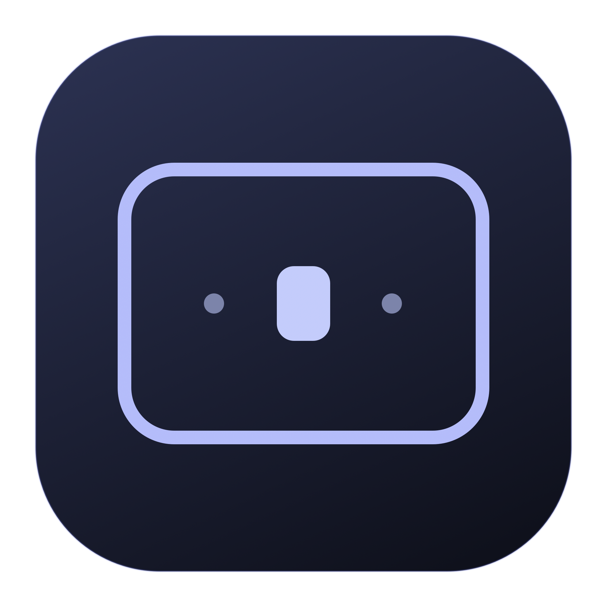

<p align="center"></p>
<h1 align="center">amspace</h1>
<p align="center">Tu espacio. Tu foco.<br>Un compañero discreto para la barra de menús de macOS, escrito en Rust.</p>
<p align="center"><a href="README.md">Español</a> · <a href="README.en.md">English</a></p>

AMSpace muestra dónde estás con un vistazo: números, puntos o iconos por escritorio. El activo destaca y los demás aparecen atenuados. Haz clic izquierdo en un número, punto o icono para cambiar a ese escritorio. El clic derecho abre unos ajustes nativos, compactos y adaptados al aspecto claro u oscuro del sistema.

## Contexto

Proyecto personal desarrollado por **Alberto Martín** para su propio uso, utilizando **Astra** y **Qwen 3.8 Flash Next**. La aplicación sigue en español. La optimización y el mínimo consumo de recursos son una prioridad máxima: está pensada para mi portátil y mi estación de escritorio con dos monitores, uno apaisado y otro vertical. Esa configuración guía el diseño, pero no implica compatibilidad o rendimiento máximos universales. [VALIDATION.md](docs/VALIDATION.md) recoge las mediciones, los escenarios realmente comprobados y sus límites.

- Instagram: [@amartinro](https://www.instagram.com/amartinro/)
- X: [@amartinro](https://x.com/amartinro)
- GitHub: [amartinrojarvis](https://github.com/amartinrojarvis)
- Otras webs del autor: [tufotoyvideopromocional.es](https://tufotoyvideopromocional.es/) · [iaparafilmmakers.es](https://www.iaparafilmmakers.es/) · [vilens.es](https://vilens.es/)
- Contacto: [a.martinro@gmail.com](mailto:a.martinro@gmail.com)

## Funciones

- **Escritorio actual.** Tres modos: Puntos, Números e Iconos. 30 iconos nativos (trabajo, código, vídeo, fotografía, comunicaciones, audio, tareas, etc.) y la opción de mantener un número en cada escritorio. El activo destaca en blanco en modo oscuro; el color se adapta al aspecto del sistema. A partir de diez escritorios se compacta a `3 / 12`.
- **Cambio de escritorio desde la barra.** Cada número, punto o icono es un botón. El clic izquierdo selecciona ese escritorio y el derecho abre ajustes. Con más de nueve escritorios, el indicador compacto abre una lista de selección.
- **Preview de escritorios.** Al mantener el cursor sobre un indicador aparece una miniatura de la distribución de ventanas, con los iconos de sus aplicaciones. Popup compacto y translúcido, sin capturar contenido ni pedir Grabación de pantalla. Se desactiva en Barra de menús. Disponible con los indicadores individuales (hasta nueve escritorios).
- **Borde de la ventana activa.** Contorno interior sin separación, con radio de esquina leído del sistema, transparente al ratón, color libre o cuatro paletas y grosor de 1 a 6 puntos, en pasos de 0,5.
- **Foco bajo el cursor.** Activa el teclado de la ventana tras detener el ratón unos 240–390 ms, incluso entre ventanas de una misma aplicación, sin cambiar su orden. Se pausa al arrastrar o mantener ⌥ y omite las propias ventanas de AMSpace. Salir de sus ajustes con el cursor permite enfocar otra app.
- **Traer al primer plano.** Ajuste independiente y desactivado inicialmente: además de enfocar, eleva la ventana sobre las demás.
- **Mosaico opcional.** Distribuciones por escritorio, agrupación de ventanas en pestañas, arrastre con previsualización y ventanas flotantes mediante atajo configurable.
- **Mission Control.** El panel del borde se oculta con la vista de escritorios y reaparece al volver al escritorio.
- **Inicio de sesión.** Registro con `SMAppService`, gestionado por macOS. Desactivado inicialmente.
- **Actualizaciones desde la app.** Versión instalada, búsqueda manual, avisos diarios opcionales, descarga verificada y reinicio mediante Sparkle.
- **Acerca de.** Autoría de Alberto Martín y enlaces a Instagram y X: [@amartinro](https://x.com/amartinro).
- **Preferencias persistentes.** Sin cuenta ni telemetría. Solo se conecta a GitHub al buscar o descargar actualizaciones; Sparkle utiliza auxiliares durante la instalación.
- **Icono propio.** Ventana redondeada con un espacio destacado; fuentes vectoriales y versión `.icns` incluidas.

El borde, el foco y el tiling están desactivados inicialmente: actívalos cuando hayas concedido Accesibilidad.

## Instalar

Requiere **macOS 13 Ventura o posterior**. [**Descargar el instalador 0.9.13**](https://github.com/amartinrojarvis/amspace/releases/download/v0.9.13/AMSpace-installer.dmg). El paquete universal contiene Apple Silicon e Intel; la ejecución local se comprueba en Apple Silicon. Consulta las novedades y archivos de la [publicación oficial](https://github.com/amartinrojarvis/amspace/releases/tag/v0.9.13).

La distribución actual está firmada **ad hoc**, sin certificado Developer ID ni notarización de Apple. Un archivo descargado puede requerir autorización explícita en Privacidad y seguridad. No desactives Gatekeeper ni SIP; también puedes compilarlo localmente.

Abre el **DMG**, arrastra AMSpace a **Aplicaciones** y lee **Léeme primero.rtf** antes de abrir la copia instalada. La ventana explica los pasos y el permiso necesario. Consulta la [guía de instalación, permisos y privacidad](docs/INSTALLATION.md). También está disponible el [ZIP](https://github.com/amartinrojarvis/amspace/releases/download/v0.9.13/AMSpace-universal.zip).

1. Abre AMSpace. Solo aparece en la barra de menús, sin icono permanente en el Dock.
2. Haz clic derecho en un escritorio de la barra para abrir los ajustes.
3. Pulsa **Accesibilidad…** y autoriza AMSpace en **Ajustes del Sistema → Privacidad y seguridad → Accesibilidad**. Si no aparece, añádelo con `+` desde Aplicaciones.
4. Vuelve a los ajustes de AMSpace y activa Borde, Foco o Mosaico cuando lo desees. Si macOS solicita reiniciar la app, sal y ábrela de nuevo.
5. Activa **Abrir al iniciar sesión** si lo deseas. macOS puede solicitar confirmar el ítem de inicio.

**El indicador de escritorios funciona sin Accesibilidad; cambiar de escritorio con un clic requiere ese permiso.** No se necesita Grabación de pantalla ni Monitorización de entrada. Accesibilidad se usa para consultar ventanas, recibir cambios de foco, activar ventanas y enviar el cambio nativo al escritorio solicitado.

## Actualizar desde AMSpace

En ajustes → **General**, pulsa **Buscar ahora**, revisa las novedades y elige **Instalar actualización**. AMSpace descarga, comprueba la firma, sustituye su paquete y se reinicia conservando tus preferencias. Si no hay novedades, lo indica. Puedes activar **Buscar actualizaciones automáticamente** para recibir avisos diarios; no se instala sin tu intervención.

El menú **Acerca de…** incluye la versión, autoría y el historial de versiones. La firma Ed25519 protege tanto el catálogo como los archivos; la clave privada permanece en el Llavero del desarrollador. Es independiente de la firma de Apple: mientras los paquetes sean ad hoc, macOS puede exigir renovar Accesibilidad tras actualizarlos.

## Compilar

Instala las herramientas de línea de comandos de Xcode y Rust con Cargo. Después:

```sh
git clone https://github.com/amartinrojarvis/amspace.git
cd amspace
./scripts/check.sh
./scripts/bundle.sh
open dist/AMSpace.app
```

Compilación universal:

```sh
rustup target add aarch64-apple-darwin x86_64-apple-darwin
./scripts/bundle.sh --universal
```

Para generar el instalador guiado desde ese bundle: `./scripts/dmg.sh`. Produce `dist/AMSpace-installer.dmg` y necesita una sesión de Finder durante el empaquetado. El usuario final no necesita herramientas de desarrollo ni permiso de Automatización. [Detalles de instalación y permisos](docs/INSTALLATION.md).

La aplicación en ejecución es Rust + AppKit/Core Animation. `scripts/icon.swift` y `scripts/dmg-background.swift` son herramientas de desarrollo para dibujar el icono y el fondo del instalador; no forman parte del ejecutable. El empaquetado descarga Sparkle 2.10.1 desde su repositorio oficial y verifica un SHA-256 fijado antes de integrarlo. Las dependencias directas de Rust son `objc2`, `objc2-foundation`, `block2` y `libc`; las versiones están fijadas en Cargo.lock.

Para regenerar los iconos: `./scripts/make-icon.sh`. Para firmar con tu certificado, define `SIGNING_IDENTITY` al ejecutar el empaquetador. La distribución notarizada requiere además configurar hardened runtime, firmar con Developer ID y enviar el paquete al servicio de notarización; este script no realiza esos pasos.

## Uso y comportamiento

El clic izquierdo selecciona el escritorio pulsado; pulsar el escritorio actual no hace nada. El clic derecho abre ajustes sin cambiar de escritorio. El cambio es directo, sin abrir la vista de Mission Control, y respeta el ajuste de desplazamiento natural. Para un destino lejano recorre los espacios intermedios y confirma cada cambio. El foco automático y el borde se pausan durante esa transición. No se modifican los atajos ni la configuración del sistema.

Los ajustes se organizan en **Ventanas**, **Barra de menús**, **Mosaico**, **Atajos** y **General**. En Barra de menús elige Iconos y configura cada escritorio con su menú; puedes mezclar símbolos y números. Las elecciones se guardan por ID del escritorio, no por su posición, para acompañarlo al reordenarlo. Un escritorio nuevo obtiene su propia elección inicial.

En Ventanas, **El foco sigue al cursor** mueve el foco del teclado; **Traer al primer plano** controla por separado la elevación. Una ventana parcialmente cubierta puede recibir el teclado al pasar por su parte visible sin apartar las ventanas que la cubren.

| Estado | Indicador |
|---|---|
| Escritorio 1 de 3 | `1 · ·` |
| Escritorio 2 de 3 | `· 2 ·` |
| Diez o más escritorios | `2 / 12` |
| Aplicación a pantalla completa | `▣` |
| API de escritorios no disponible | `—` |

Los números son relativos a los escritorios normales de la pantalla que contiene el puntero, en el orden de Mission Control; si el puntero no resuelve, se usa la pantalla del escritorio activo de WindowServer. Con Spaces por pantalla, cada monitor numera sus propios escritorios. Las ventanas a pantalla completa no se cuentan como escritorios normales. El orden puede cambiar si macOS tiene activado reordenar Spaces por uso reciente.

El borde sigue la ventana enfocada por AMSpace y respeta su posición en la pila; fuera de ese seguimiento, usa la ventana normal delantera de la aplicación activa; distingue ventanas de una misma app y recibe eventos de creación y cierre. No rodea la propia ventana de ajustes de AMSpace.

Los ajustes admiten navegación con teclado y etiquetas de Accesibilidad. Con la app activa: `⌘,` abre ajustes, `⌘W` cierra su ventana y `⌘Q` sale. Cerrar los ajustes deja el indicador en funcionamiento.

Las colocaciones del mosaico se interpolan con una curva suave (160 ms, una escritura por atributo cambiado en cada fotograma). Puedes desactivar esa interpolación con **Animar colocaciones** en Mosaico: cada ventana pasa a su destino con una única escritura AX y el temporizador vuelve al ritmo de reparación. Al reelegir el escritorio ya activo no hay deslizamiento nativo, así que AMSpace dibuja un marco rojo suave a pantalla completa como confirmación; se apaga con **Borde al reelegir el escritorio** en Barra de menús. Ambos interruptores guardan su valor en `tile.animate` y `flash`.

### Pestañas y ayudas

- **Clic derecho o Control-clic en una pestaña:** separar del grupo, hacer flotante, mover a otro grupo del mismo escritorio y pantalla, o cerrar la ventana. El cierre respeta las confirmaciones de guardar de la aplicación; no fuerza su terminación.
- **Atajos configurables en Ajustes → Atajos:** pestaña anterior, siguiente y separar la activa. Inicialmente desactivados; sus combinaciones propuestas son `⌃⌥←`, `⌃⌥→` y `⌃⌥D`. La edición rechaza conflictos internos sin perder la configuración anterior.
- **Pausar Mosaico:** botón siempre visible en la barra lateral de Ajustes y acción en el menú de pestañas. Conserva la distribución, cancela las colocaciones pendientes y detiene su temporizador y monitor de arrastre. Mientras está pausado no se reorganizan ni trasladan ventanas desde AMSpace. Borde, foco y navegación de escritorios siguen siendo independientes. La pausa dura hasta reanudar o cerrar la app; no cambia la preferencia de activación.
- **Ayuda inicial desactivable:** instalación, permisos, privacidad y gestos en una ventana nativa. Se puede volver a abrir desde General → Instalación y ayuda. La casilla «Mostrar ayudas en los primeros usos» controla las ayudas iniciales, no los avisos de error.
- **Motivos concretos:** los destinos incompatibles explican capacidad o tamaños mínimos; las operaciones rechazadas muestran un aviso temporal incluso con Ajustes cerrado. No hay sondeo nuevo para la guía, los menús o los avisos.
- **Color integrado:** la pestaña activa utiliza el color elegido para el borde, oscurecido solo cuando hace falta para mantener el contraste del título y del cierre. El icono conserva sus colores originales sobre una base neutra. El color se calcula al cambiar la preferencia y se aplica a los controles existentes, sin sondeo ni consultas adicionales de títulos.

La agrupación conserva el límite configurable de **5 pestañas** por defecto (2–20), la barra exterior y la separación por arrastre. Reducir el máximo no disuelve grupos existentes.

## Eficiencia

- En reposo normal, sin sondeo de ventanas con foco automático y Mosaico desactivados. La búsqueda automática de versiones, opcional y desactivada inicialmente, se programa una vez al día.
- Spaces se consulta al cambiar de escritorio, aplicación o pantalla y al abrir ajustes. Con Mosaico activo hay además reconciliación periódica para recuperar notificaciones ausentes.
- El borde identifica la ventana por su ID de WindowServer. El movimiento se aplica directamente desde la notificación del compositor, sin redibujar ni esperar a Accesibilidad. El tamaño se actualiza en el siguiente turno del hilo principal, sin demora artificial; no hay un bucle de animación permanente.
- El foco opcional utiliza un temporizador tolerante cada 80 ms. Solo realiza hit-testing AX y de WindowServer después de que el cursor se detenga, una vez por posición; no escanea continuamente todas las ventanas.
- «Mostrar escritorio», incluida la esquina activa, suspende tiling, foco y borde. Las ventanas nuevas quedan flotantes al volver; los mosaicos anteriores conservan su distribución por pantalla/escritorio. En macOS reciente se detecta la presentación de WindowManager desde los metadatos del compositor, con comprobación de salida solo mientras está activa.
- Los menús abiertos conservan el seguimiento de teclado aunque el cursor salga de su área. Modales, Obtener información/Inspector de Finder, la Utilidad de Compresión y los paneles de servicio del sistema (progreso de copia, Abrir/Guardar, Vista de Safari) quedan fuera del mosaico: conservan su propia geometría.
- La animación del mosaico y el marco de confirmación no añaden sondeo: los fotogramas los produce el temporizador ya existente y el marco usa dos entregas diferidas únicos, reemplazables con un nuevo clic.
- El foco bajo el cursor se pausa durante la entrada segura de macOS y respeta los campos de contraseña, diálogos modales y hojas de la aplicación activa, también al completar una activación diferida.
- Los segmentos de la barra conservan los botones y acciones accesibles nativos, con dibujo directo de sus títulos para evitar que las instantáneas de AppKit provoquen repintados continuos. La lectura de metadatos reutiliza claves constantes y recorre las listas nativas sin copiarlas a vectores temporales.
- Se suspende el foco y se oculta el borde al dormir la pantalla, suspender el equipo o desactivar la sesión.
- Compilación optimizada con LTO, eliminación de símbolos y un único codegen unit.

Consulta [VALIDATION.md](docs/VALIDATION.md) para las mediciones locales y el alcance real de las pruebas; no son una garantía para todos los equipos.

## Limitaciones conocidas

macOS no ofrece una API pública para enumerar todos los Spaces. El módulo `spaces.rs` consulta metadatos mediante funciones privadas de SkyLight resueltas en ejecución. El envío de ventanas a otro escritorio usa, cuando está disponible, el puente de WindowManager; su entrada se localiza por el nombre exacto en la tabla Mach-O de la imagen cargada, sin escanear instrucciones ni modificar memoria. No inyecta código, no modifica Dock y no requiere desactivar SIP. Si Apple cambia esas funciones o sus datos, el indicador presenta `—` y el resto de ajustes continúa disponible. El borde también utiliza funciones privadas para recibir eventos de ventana, consultar radios y mover únicamente su propio panel. El borde no modifica la geometría de las ventanas de otras apps; el mosaico y los traslados sí la ajustan mediante Accesibilidad. Por esas dependencias, esta versión está pensada para distribución directa, no para la Mac App Store.

- Al añadir, eliminar o reordenar escritorios sin cambiar de Space, el indicador puede actualizarse en el siguiente cambio de aplicación/escritorio o al abrir sus ajustes.
- La geometría y el orden del borde se leen de WindowServer, con notificaciones AX como respaldo si la API privada no está disponible. Algunas apps y versiones de macOS pueden exponer metadatos o notificaciones incompletos. El código limita los tiempos de espera AX.
- El foco se aplica solo a ventanas estándar; se omiten diálogos, menús, escritorio y ventanas de AMSpace. Activación y elevación son independientes. La activación sin elevar usa símbolos opcionales de SkyLight y puede no estar disponible si Apple los modifica; no requiere desactivar SIP.
- El borde es un panel independiente: no se inyecta dentro de otras apps. El movimiento usa una ruta directa del compositor y el redimensionado es reactivo; no se garantiza sincronía atómica con todos los fotogramas de otra aplicación. Mission Control, Stage Manager, apps de ventanas flotantes y animaciones de pantalla completa pueden presentar transiciones visuales. El borde no intenta integrarse con sus animaciones privadas.
- El inicio de sesión requiere un paquete `.app` instalado. `cargo run` no es un método de instalación.
- Tras recompilar con firma ad hoc, macOS puede requerir **eliminar AMSpace de la lista de Accesibilidad y añadir de nuevo la copia de Aplicaciones**. Apagar y encender el interruptor no siempre renueva la firma guardada. En versiones recientes del sistema el panel puede llamarse «Control de dispositivos y acceso a datos».

## Desarrollo

```sh
./scripts/check.sh                         # formato, Clippy, pruebas y plist
./scripts/bundle.sh --universal             # compila, empaqueta y verifica la firma
dist/AMSpace.app/Contents/MacOS/amspace --diagnose
python3 scripts/benchmark.py <PID> --seconds 20
swift scripts/benchmark-status.swift --baseline # reproducción aislada, siete segundos
swift scripts/benchmark-status.swift            # dibujo optimizado, siete segundos
```

[Guía para agentes](AGENTS.md) · [Desarrollo y diagnóstico](docs/DEVELOPMENT.md) · [Contratos nativos y regresiones](docs/NATIVE_INVARIANTS.md) · [Arquitectura](docs/ARCHITECTURE.md) · [Validación y pruebas manuales](docs/VALIDATION.md) · [Licencia MIT](LICENSE)

Las preferencias viven en el dominio `io.github.amartinrojarvis.amspace` de `NSUserDefaults`. Para desinstalar: desactiva inicio de sesión, sal de la app, elimina AMSpace de Aplicaciones y retira su permiso de Accesibilidad si lo deseas.

## Autoría

Creado por **Alberto Martín** · [Instagram @amartinro](https://www.instagram.com/amartinro/) · [X @amartinro](https://x.com/amartinro).

[Publicación de actualizaciones](docs/UPDATES.md) · [Licencia de Sparkle](docs/SPARKLE-LICENSE.txt) · [Atribución de foco y puente de ventanas de yabai](docs/YABAI-LICENSE.txt) · [Licencia del protocolo de gestos de iss](docs/ISS-LICENSE.txt) · [Atribución de strafe](docs/STRAFE-LICENSE.txt)

## Enviar feedback

En **Ajustes → General → Enviar feedback…**, o desde el menú de la app, se abre un panel nativo con el correo visible y seleccionable. **Preparar correo** abre un borrador en el cliente predeterminado: revísalo y envíalo tú mismo. No se adjuntan diagnósticos automáticamente. Si no tienes un cliente configurado, usa **Copiar dirección** y escribe desde tu webmail. AMSpace no envía el mensaje ni añade servicios en segundo plano.

## Tiling por escritorio

Actívalo en **Ajustes → Mosaico** después de conceder Accesibilidad. El interruptor general activa el gestor; el segundo permite excluir el escritorio actual. Cada escritorio conserva su plantilla por ID, aunque se reordene en Mission Control. Las pantallas visibles se gestionan de forma independiente y se respeta su área útil (Dock y barra de menús).

- **Espiral (predeterminada):** divisiones sucesivas en sentido horario. Las preferencias antiguas de Dwindle pasan a Espiral.
- **Cuadrícula simétrica:** filas y columnas equilibradas; la última fila aprovecha el ancho completo.
- **Principal centrada:** principal con dos tercios del ancho, a toda altura, y hasta dos secundarias apiladas a cada lado. Las secundarias alternan izquierda y derecha; si hay más de cuatro secundarias, se subdividen las dos filas de cada lado. Con una ventana se aprovecha toda el área; con dos se reserva el lateral libre para mantener la principal centrada. Los mínimos de las apps y la rejilla pueden ajustar las proporciones.
- **Centrada XL:** principal con dos tercios del ancho y tres secundarias apiladas a cada lado (siete ventanas).
- **Principal vertical:** principal centrada con dos tercios del alto y dos secundarias arriba y dos abajo (cinco ventanas). Se mantienen esas orientaciones aunque se apliquen en otra pantalla.
- **Principal y secundarias:** ventana principal al 60 % del ancho y columna de ventanas secundarias; se apila en pantallas verticales.
- **3 / 4 divisiones:** tres o cuatro columnas en una pantalla horizontal y tres o cuatro filas en una vertical. Si hay menos ventanas, ocupan las divisiones disponibles sin huecos; si hay más, se reparten dentro de ellas.

Arrastra una ventana tiled por su barra de título para intercambiarla con el hueco de otra ventana del mismo escritorio. Se respeta la rejilla virtual de la plantilla, incluso cerca de sus bordes y tras elegirla desde el atajo: no se crean divisiones nuevas durante esa recolocación. La vista previa muestra el hueco de destino y coincide con el resultado al soltar. Si los tamaños mínimos no permiten el intercambio, se conserva la distribución anterior. En un traslado entre monitores, la colocación inteligente sigue ofreciendo divisiones de llegada en los bordes.

Con **Agrupar como pestañas** activo, soltar en el tercio superior de un hueco añade la ventana arrastrada a ese hueco como una pestaña más: las dos comparten un único hueco y una de ellas queda visible, la otra conserva su geometría exacta para que al seleccionarla no haya un segundo ajuste. Soltar en los dos tercios inferiores sigue intercambiando huecos como siempre. La tira vive en el modelo del mosaico; las pestañas nativas de cada aplicación (su `AXTabGroup`) siguen usando su propio mecanismo.

Desde la versión 0.9.8 las pestañas se sitúan en una barra oscura translúcida de **22 puntos**, **por encima del borde superior de la ventana**, con 4 puntos de separación. El mosaico reserva ese espacio dentro del hueco: no tapa los controles de la aplicación, las ventanas vecinas ni el menú. La pestaña activa queda resaltada; los grupos de una sola ventana recuperan todo el alto.

Haz clic en una pestaña para activar y elevar esa ventana. **Arrastra cualquier pestaña y suelta para separarla** en un hueco independiente del mosaico, también si no era la activa; la previsualización muestra su destino. Un movimiento menor de 6 puntos sigue siendo un clic. Si no cabe respetando los mínimos de las aplicaciones, la distribución no cambia. Si no caben todos los títulos, desplaza horizontalmente la tira. Sigue siendo posible sacar la ventana activa arrastrando su barra de título. Las agrupaciones duran la sesión, no se guardan como parte de las plantillas.

Desde **0.9.9**, cada pestaña incorpora una **×** para solicitar el cierre de su ventana, no solo separarla del grupo. Se utiliza el cierre normal de la aplicación, sin forzar la salida ni descartar documentos. Si la pestaña estaba oculta se selecciona antes, para mostrar cualquier aviso de guardar. Cancelar ese aviso conserva la ventana; la pestaña solo se retira cuando se confirma el cierre. Soltar fuera de la × cancela el clic.

En **Ajustes → Mosaico → Máximo de pestañas** se configura el límite por grupo: **5 por defecto**, entre 2 y 20. Reducirlo no deshace los grupos existentes: impide añadir nuevos miembros a los que ya alcanzan el límite.

Desde **0.9.10**, alineación a la izquierda con 8 puntos de margen de forma predeterminada, o centrada desde **Ajustes → Mosaico → Alineación de pestañas**. El fondo oscuro translúcido se limita a la tira, con esquinas redondeadas, borde tenue y sombra discreta. La × se muestra en la pestaña activa y al pasar el cursor por las demás, sin desplazar el título ni cambiar el área de cierre. El seguimiento usa eventos nativos, sin añadir sondeo ni animaciones continuas.

Puedes arrastrar entre monitores visibles, incluso con orientaciones, resoluciones y escalas distintas. Cada pareja monitor/escritorio mantiene su propio árbol; se usa el área útil en puntos de macOS y se respetan Dock, menú y márgenes. Espiral y Principal comienzan apiladas en pantallas verticales. También se separan las distribuciones cuando macOS comparte un Space entre monitores. También puedes enviar la ventana activa a otro escritorio desde Atajos, cuando macOS admite el puente nativo. Las flotantes permanecen fuera de esta colocación hasta usar su atajo.

**⌃⌥Espacio** abre el selector semitransparente en el monitor del cursor. Muestra las ocho plantillas con miniaturas adaptadas a esa pantalla, más una tarjeta por cada plantilla guardada, y una previsualización a tamaño real con las ventanas actuales. Pasa el ratón, usa las flechas o pulsa 1–8 (9 y 0 para las dos primeras guardadas) para previsualizar; haz clic o pulsa Intro para aplicar. Esc, otro toque del atajo o un clic fuera del panel cancelan. Las miniaturas de las integradas son ejemplos, mientras que la previsualización grande usa las ventanas reales. Las opciones que no cumplen el tamaño mínimo o el número de ventanas aparecen deshabilitadas. Configura la combinación en **Atajos → Selector de plantillas**. La elección se guarda por monitor y escritorio, también si varios monitores comparten un Space. Ahora hay 54 teclas (letras, números, F1–F12, flechas, Espacio y Retorno) y 12 combinaciones de modificadores. En **Atajos → Sugerencias… → Buscar atajos libres**, AMSpace consulta los atajos de sistema y prueba reservas globales exclusivas en ese Mac. Elige una sugerencia y pulsa **Usar sugerido**; vuelve a reservarse al aplicarla. La comprobación no puede enumerar todos los atajos internos de otras apps. Las sugerencias deben buscarse en el ordenador donde se usarán.

**⌃⌥T** alterna la ventana activa entre flotante y tile. En los ajustes puedes elegir modificadores y tecla entre las combinaciones disponibles. Carbon registra el atajo para que no llegue simultáneamente a la aplicación enfocada; un conflicto se indica en ajustes. Una flotante permanece flotante aunque la muevas o redimensiones: solo vuelve al tile mediante el atajo. Desactivar el gestor o excluir un escritorio restaura la geometría guardada de sus ventanas.

El borde y el foco bajo el cursor siguen funcionando; el mosaico no activa ni eleva ventanas al distribuirlas. Se excluyen diálogos, ventanas no redimensionables, minimizadas, pantalla completa, ventanas propias y ventanas asignadas a todos los escritorios. Algunas aplicaciones imponen tamaños mínimos: las divisiones se ajustan conservando la plantilla, incluida Espiral. Si no cabe, el selector la deshabilita y los ajustes muestran un aviso; usa otra plantilla o deja esa ventana flotante.

Esta es una adaptación nativa de la interacción de [Omarchy/Hyprland](https://github.com/omacom/omarchy/blob/master/default/hypr/bindings/tiling.lua), no un compositor Hyprland: no incluye pseudotiling, scratchpads ni todos sus atajos. Las plantillas y ajustes persisten; el árbol, el orden, los grupos y las ventanas flotantes son estado de la sesión. El guardado de proporciones y rejilla por escritorio está disponible; los perfiles con identidad de aplicaciones y monitores quedan para una ampliación futura.


### Redimensionado y aplicaciones flotantes

Arrastra un borde o esquina de una ventana tiled: macOS controla la ventana durante el gesto y AMSpace calcula las divisiones desde su geometría inicial. Si activas **Previsualizar al redimensionar**, muestra el reparto propuesto; al soltar confirma la proporción y coloca las vecinas. Los límites exteriores permanecen fijos y se respetan los mínimos de cada aplicación, además del mínimo de 120 × 90 puntos por hoja. Seleccionar una plantilla, incluso la actual, reconstruye su reparto inicial. Cerrar una ventana conserva las proporciones ajustadas de las demás divisiones; su hermana ocupa el hueco liberado.

Las recolocaciones automáticas se interpolan durante 160 ms con una curva quintic ease-in/ease-out, de velocidad y aceleración nulas en los extremos. Un gesto real interrumpe las escrituras pendientes para dar prioridad al ratón; AMSpace no compite con el redimensionado nativo mediante escrituras AX por fotograma.

En **Mosaico → Apps flotantes… → Añadir aplicación…**, selecciona una aplicación instalada. El listado permite quitar reglas y se conserva entre reinicios. Cada regla se identifica por el bundle ID de la aplicación y se aplica cuando el gestor incorpora una ventana nueva; no modifica retroactivamente las ya gestionadas. El atajo permite devolver al tile una ventana concreta sin eliminar la regla de su aplicación.


El gestor comprueba la geometría real al reajustar: una animación interrumpida no deja su destino marcado como completado. La expansión vuelve a aplicarse después de colocar la ventana, evitando tamaños limitados por su posición anterior. Al retirar tiles, las restantes ocupan el área útil completa, respetando los márgenes y gaps. Si una división produce tiles demasiado pequeños se ajustan sus proporciones dentro de la plantilla elegida; los límites impuestos por aplicaciones se notifican sin reintentar indefinidamente.

El temporizador de tiling funciona a 60 Hz durante animaciones y arrastres, a 12,5 Hz durante asentamiento/verificación y a 4 Hz en reposo. La reconciliación ordinaria de pantallas y ventanas usa un intervalo de 500 ms, salvo cambios explícitos y trabajo pendiente. Los fotogramas intermedios solo escriben los atributos que cambian. El compositor de macOS presenta las ventanas; AMSpace no captura texturas ni añade una segunda copia gráfica de ventanas ajenas. Estos intervalos son objetivos del programador, no una garantía de FPS: la respuesta AX depende de cada aplicación.


### Rejilla virtual y distribución guardada

En **Mosaico → Rejilla y distribución…** puedes activar el ajuste a una rejilla virtual. Valores iniciales: **120 columnas × 6 filas**, configurables entre 2–240 columnas y 2–60 filas. Pulsa **Aplicar rejilla** tras editar. Se ajustan las divisiones compartidas, respetando gaps y tamaños mínimos, no cada ventana por separado. Si una alineación no cabe por los mínimos de un subárbol, prevalece el mínimo.

**Guardar distribución** conserva una distribución de tamaños por escritorio: plantilla, proporciones, estructura y rejilla. **Restaurar distribución** la aplica a los tiles presentes y requiere el mismo número de ventanas. Usa posiciones lógicas, no IDs de ventana guardados, por lo que puede restaurarse después de reiniciar. No abre aplicaciones ni identifica documentos, y no es todavía un gestor de perfiles multipantalla con nombres.

Recolocar las ventanas de una cuadrícula ajustada conserva sus huecos y proporciones; intercambia o reordena qué ventana ocupa cada hueco. Redimensionar desde una esquina exterior ajusta la división interna opuesta manteniendo el límite de pantalla, incluido el caso de una ventana izquierda y dos apiladas a la derecha.


Al cambiar de Space, el gestor conserva el mosaico y pausa las consultas y escrituras de geometría durante 400 ms desde el último aviso para dejar terminar la transición nativa. Después exige muestras estables y consulta la pertenencia con mayor frecuencia durante otros 600 ms, antes de volver al sondeo habitual. Al trasladar una ventana a otro Space, elimina su hoja del origen sin reiniciar las proporciones y la coloca directamente en el destino, evitando una segunda animación. Las lecturas transitoriamente incompletas no equivalen a ventanas cerradas.


En Espiral, las ventanas nuevas continúan el giro de la última división, aunque otra ventana tenga el foco. Se conservan los tamaños ajustados y el sentido del giro después de cerrar ventanas. La aplicación no sustituye automáticamente Espiral por Cuadrícula: si no caben los mínimos, muestra un aviso. Puedes reconstruir la forma inicial volviendo a elegir **Espiral** en el selector de plantilla.

Los ajustes usan navegación lateral: Ventanas, Barra de menús, Mosaico y General. Mosaico muestra las ocho plantillas como tarjetas con miniaturas y selección directa. En Barra de menús puedes aplicar un fondo de color al widget: azul, salvia, lavanda, arena, rosa o gris, con la paleta y transparencia de Kairos Monitor. «Sin color» conserva el aspecto anterior. El fondo se guarda por usuario y utiliza una capa nativa estática, sin temporizadores ni imágenes adicionales.

Todas las plantillas permiten ajustar las divisiones compartidas arrastrando bordes y esquinas. Las posiciones conservan los tamaños ajustados cuando intercambias las ventanas. En Centrada, Centrada XL y Principal vertical, las divisiones que delimitan a la principal se mueven simétricamente para mantenerla en el centro. Se respetan los mínimos de las aplicaciones y, si está activada, la rejilla de ajuste.

## Atajos globales y traslado de ventanas (0.7)

La sección **Atajos** reúne las combinaciones del selector, ventana flotante, cambio de escritorio y traslado de ventanas. Los atajos nuevos de navegación se activan con su propio interruptor; están desactivados inicialmente. Se conservan los atajos anteriores de Mosaico.

| Acción | Combinación inicial |
|---|---|
| Ir al escritorio 1–9 de la pantalla activa | ⌘1–9 |
| Enviar la ventana al escritorio 1–9 de su pantalla | ⌘⇧1–9 |
| Enviar a la pantalla izquierda | ⌃⌘⌥← |
| Enviar a la pantalla derecha | ⌃⌘⌥→ |
| Alternar flotante/mosaico | Se conserva la combinación existente; inicialmente ⌃⌥T |
| Selector de plantillas | Se conserva la combinación existente; inicialmente ⌃⌥Espacio |

Las pantallas izquierda/derecha se eligen por su posición física, sin volver al extremo contrario cuando no existe otra pantalla. No se envía a una pantalla que muestra una aplicación a pantalla completa. Los números de escritorio se resuelven en cada pulsación, por el orden actual de Mission Control; no se guarda un ID obsoleto como destino.

**Dar prioridad a los atajos de AMSpace**, desactivado inicialmente, filtra únicamente las combinaciones configuradas antes de que lleguen a las aplicaciones. El estado indica si está activo, suspendido o si se han usado reservas normales como alternativa. No garantiza prioridad absoluta frente a macOS, entrada segura ni otros interceptores. No se registran textos ni historial del teclado. Las combinaciones duplicadas dentro de AMSpace se rechazan conservando los ajustes previos; las reservas normales muestran cuántas combinaciones no están disponibles.

**Al enviar a otro escritorio, permanecer en el origen** está activado inicialmente. Desmárcalo para seguir a la ventana, después de que macOS confirme su traslado. La operación comprueba identidad, tipo de ventana, ubicación y disponibilidad del destino. Se rechazan ventanas fijadas a varios escritorios, diálogos, pantalla completa y entrada segura. Los traslados tienen un plazo acotado, sin reenvíos repetidos entre Spaces. La llegada se confirma antes de confirmar el modelo del mosaico; un fallo deja el modelo sin esa propuesta y la reconciliación normal comprueba el estado real.

El origen libera el hueco tras confirmar la llegada. El destino conserva su plantilla, rejilla, proporciones y ventanas existentes; se valida una copia antes de pedir el traslado. Si el destino está oculto, se coloca su mosaico en segundo plano antes de completar el traslado, sin activarlo. Las aplicaciones que rechacen esa colocación se reconcilian al entrar. Las flotantes siguen siendo flotantes. La función depende de que macOS acepte el puente nativo; si no está disponible, se indica en Atajos. No necesita desactivar SIP ni inyectar código.

El cambio de escritorio conserva el mecanismo nativo por saltos, también para los atajos. Saltar de 1 a 3 puede recorrer el 2; no se utiliza una selección que solo cambie el número reportado sin cambiar la presentación real.

## Plantillas personalizadas (0.8)

[Última publicada: 0.9.13](https://raw.githubusercontent.com/amartinrojarvis/amspace/updates/0.9.13/AMSpace-universal.zip) · [Notas publicadas](https://github.com/amartinrojarvis/amspace/releases/tag/v0.9.13).

La versión 0.8.0 añade **Mosaico → Rejilla y plantillas**: escribe un nombre y pulsa **Guardar actual** para conservar las divisiones y proporciones de esa pantalla. Elige una plantilla para ver su preview y aplicarla a otro escritorio con el mismo número de ventanas en mosaico. Las aplicaciones no se abren automáticamente; se conserva la rejilla del destino. Puedes eliminar diseños sin modificar el mosaico aplicado. La copia rápida por escritorio sigue disponible.

La versión 0.8.1 extiende el selector de ⌃⌥Espacio a esas plantillas guardadas: cada una ocupa una tarjeta con su nombre y su miniatura, se previsualiza con las ventanas reales y se aplica con Intro o clic. Solo se habilitan las que tienen el mismo número de huecos que el mosaico de esa pantalla y caben en su área útil.

La versión 0.8.2 hace que el indicador y los atajos ⌘1–9 sigan la numeración del monitor que contiene el puntero; 0.8.3, 0.8.4 y 0.8.5 dejan el mosaico asentado con una única escritura por ventana al volver a un escritorio: cada ventana conserva su hueco desde el primer escaneo, sin el doble ajuste visible anterior. 0.8.6 baja el temporizador a 0,25 s en reposo con una sola lista del compositor por cuadro; 0.8.7 cubre también las listas transitorias con hueco en el medio o id extra provisional tras varios gestos; 0.8.8 comparte una única lectura nativa de pertenencia por cuadro, acota la ráfaga de lecturas incompletas y hace converger el mínimo aprendido, y 0.8.9 extiende ese memo al grupo de pestañas nativa.

La versión 0.9.0 hace conmutable el lote interpolado del mosaico (**Animar colocaciones**, `tile.animate`: con 0 queda una única escritura por ventana y el temporizador de reparación), dibuja el marco de reelección con esquinas suavemente redondeadas sobre el `visibleFrame` para que se vean sus cuatro lados bajo la barra de menús (**Borde al reelegir el escritorio**, `flash`) y suma los paneles de servicio del sistema —progreso de copia, Abrir/Guardar y Vista de Safari— a las aplicaciones flotantes permanentes, que conservan su propia geometría.

La versión 0.9.1 también dibuja ese marco cuando el traslado de una ventana no cambia de destino (la ventana ya estaba en ese escritorio), de modo que la ausencia de deslizamiento nativo sigue teniendo confirmación visible. Las demás incidencias de traslado muestran solo su texto.

La versión 0.9.2 acorta los plazos fijos que marcan la latencia visible, sin añadir sondeos: la verificación de una escritura final y su único reintento pasan a 60 ms, la barrera de reentrada admite dos muestras coincidentes durante 60 ms, la pausa tras el aviso de escritorio baja a 400 ms y con ella la del borde, y el asentamiento por salto y el reintento de colocación oculta quedan en 120 ms. El ritmo del temporizador no cambia (1/60 s con movimiento, 80 ms con verificación o asentamiento en vuelo, 250 ms en reposo).

La versión también protege los diseños editados al cambiar de Space en otro monitor y cuando una app tarda en responder a AX. Cuando no se ha configurado otro modificador, el envío usa **⌃⌘1–9**; el grupo debe estar activado en Atajos. General incluye **Copiar diagnóstico** de la instancia abierta. El estado de las comprobaciones físicas está en [VALIDATION.md](docs/VALIDATION.md).

La versión 0.9.3 añade los **grupos de pestañas del mosaico**: al soltar en el tercio superior de un hueco, la ventana arrastrada pasa a ese hueco como una pestaña más y las dos comparten un único hueco del árbol, sin dividir la pantalla ni perder las proporciones ajustadas. El interruptor **Agrupar como pestañas** (Mosaico, clave `tile.groups`, ausente = 1) activa o desactiva esa intención para los gestos siguientes. Cerrar la pestaña visible promueve a su hermana en el mismo rectángulo, y seleccionar una pestaña nativa sigue reutilizando la hoja ya existente.

La versión 0.9.4 dibuja esas tiras y los iconos de intención. Cada grupo muestra su tarjeta con el icono y el título de cada pestaña, con la activa resaltada, y el destino del arrastre se anuncia con un símbolo del sistema: apilado o intercambio.

La versión 0.9.5 refresca la línea de permiso de Accesibilidad en cada cuadro del temporizador de la ventana de Ajustes, de modo que el círculo se pone lleno nada más conceder el permiso en Preferencias del Sistema, sin tocar ningún control.

La versión 0.9.6 añadió comprobaciones de objetos ausentes en Sparkle, pero no resolvió correctamente la propiedad del icono. La 0.9.7 retiene el resultado prestado de `icon` y convierte `AXTitle` mientras su objeto sigue vivo; añade selección desde la tira y corrige la geometría compartida y las transiciones del modelo de grupos. La validación y sus límites se registran en [VALIDATION.md](docs/VALIDATION.md). Se publica por autorización del usuario; falta completar la comprobación nativa AX.
